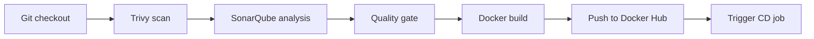

# Sumit Kumar

**DevOps & Cloud Engineering | CI/CD | AWS | Docker | Kubernetes**

Final-year B.Tech CSE student at NIST University, seeking DevOps, Cloud and DevSecOps internships and fresher roles.

---

## About

I build and deploy containerised applications and CI pipelines, mostly with Docker, Jenkins and AWS. My projects cover the path from source code to a running server: image builds, reverse proxying, security scanning and automated delivery. I am strengthening my Kubernetes, Terraform and Linux skills.

---

## Featured Projects

| Project | What it demonstrates | Stack |
|---|---|---|
| [**TravelTales India**](https://github.com/smk233/traveltales-india) | Jenkins CI pipeline for a MERN travel blogging app: Trivy filesystem scan, SonarQube analysis with quality gate, Docker image build and push to Docker Hub, then CD job trigger | Jenkins, Docker, Docker Hub, Trivy, SonarQube, Node.js, React |
| [**Django Notes App: DevOps Deployment**](https://github.com/smk233/django-notes-app-devops) | Multi-container deployment on AWS EC2 with Nginx as reverse proxy in front of Gunicorn/Django and a MySQL database. Based on an open-source app by Shubham Londhe; the DevOps layer is my work | Docker, Docker Compose, Nginx, Gunicorn, MySQL, AWS EC2, Ubuntu |
| [**Personal Portfolio**](https://github.com/smk233/myportfolio) | Static site built with HTML, CSS and JavaScript, deployed through a GitHub Actions workflow (`CONFIRM`: S3 deployment) | HTML, CSS, JavaScript, GitHub Actions |

### TravelTales CI pipeline (from the repo's `Jenkinsfile`)

---

## Tech Stack

**Used in my projects**

**Currently learning**

---

## CI/CD and DevSecOps Tooling

| Tool | Where I used it |
|---|---|
| Jenkins (declarative pipeline, shared library) | TravelTales India |
| Trivy | TravelTales India: filesystem scan stage |
| SonarQube | TravelTales India: analysis and quality gate |
| Docker Hub | TravelTales India: image registry |
| Docker Compose + Nginx | Django Notes App |
| GitHub Actions | Personal Portfolio |

---

## CSE Fundamentals

Linux (Ubuntu) administration, Git and GitHub workflows, networking basics, Java, data structures and algorithms, backend development.

---

## Currently Learning

- Kubernetes: deploying and operating workloads on a cluster
- Terraform: infrastructure as code for AWS
- Deeper AWS and Linux administration
- Java, DSA and backend development

---

## GitHub Activity

---

Open to DevOps, Cloud and DevSecOps internships and fresher roles.
The best way to reach me is [LinkedIn](https://www.linkedin.com/in/sumitsmk/).

